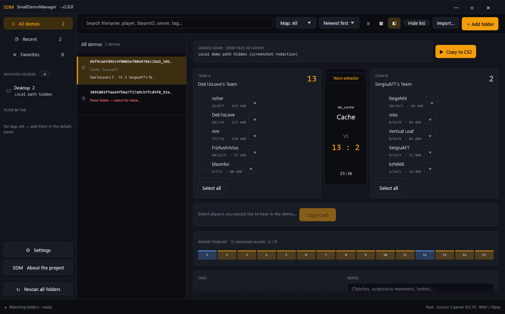

<div align="center">

# 🎧 Small Demo Manager

**A native, all-in-one demo manager for Counter-Strike 2.**
Browse your library, inspect matches, extract per-player voice chat, and copy
in-game spectator commands — with the familiar dark/amber design, rebuilt in Rust.

[](https://github.com/thedarkcr0w/Small-Demo-Manager/releases/latest)
[](#-runtime-requirements)
[](Cargo.toml)
[](LICENSE)



*Native Rust match view. Local file paths are hidden in this screenshot.*

</div>

---

> [!NOTE]
> **2.x is the Rust rewrite.** If you're coming from 1.x, download the Windows
> ZIP below and add your demo folders. The old app's library and settings are
> ignored, not deleted. See the
> [patch notes](PATCHNOTES.md) for the changes and known issues.

## ✨ Features

| | |
|---|---|
| 📁 **Watched folder library** | Recursively watches your demo folders, refreshes changed files, and offers table, card, and hybrid layouts. |
| 🔎 **Library search** | Find demos by filename, parsed player or SteamID, map, server, team, tag, or note. Optional background parsing makes player search work across the library. |
| 🏆 **Match details** | Recorded scoreboards, K/D/A, damage, ADR, and observed round results. Missing data stays unavailable — no invented IDs, ratings, or stats. |
| 🎙️ **Per-player voice extractor** | Extract one player or everyone to WAV, with measured waveforms and native audio playback. Previous extractions are kept. |
| 📣 **Spectator voice commands** | Select players and copy the correct low/high `tv_listen_voice_indices` masks. Profile links use recorded SteamIDs. |
| 🗂️ **Tags, notes & favorites** | Save annotations in the native library; in-app renames and transfers preserve them. The old app's library is not imported. |
| 🪟 **Copy or move to CS2** | Copy by default, or move with an optional backup. SHA-256 verification happens before removing the source; existing files are never overwritten. |
| 🎯 **Auto-detect CS2 install** | Finds Steam libraries and checks for a real CS2 game directory. |
| 🖱️ **Drag-and-drop import** | Import `.dem` files and ZIP archives, keeping the originals. Extract RAR/7z archives first. |
| 🔄 **GitHub auto-updater** | Checks for releases at startup, downloads updates in the background, verifies SHA-256, and installs after you confirm a restart. Keeps a rollback backup; old .NET builds are excluded. |

Only voice actually recorded in a demo can be extracted. WAV is the supported
export format; MP3/FLAC and match-lobby discovery are not offered.

---

## ⚙️ Runtime Requirements

**Windows 10 or 11, x64**, with an OpenGL 3.3-capable graphics driver. An audio
output device is needed for playback.

**No .NET, WebView2, Node.js, browser, or FFmpeg is required.** The Opus decoder is
built into the app. Windows x64 is the distribution target; other platforms are
not release-tested.

> [!IMPORTANT]
> Valve occasionally changes the CS2 demo format. This release includes fixes for
> string tables, game modes, voice packets, and recordings without final metadata.
> Exact newest-patch compatibility still needs a fresh demo recorded on that patch;
> a recent download date alone does not establish compatibility.

---

## 📥 Installation

1. Download **[`SmallDemoManager-native-windows-x64.zip`](https://github.com/thedarkcr0w/Small-Demo-Manager/releases/download/v2.0.1/SmallDemoManager-native-windows-x64.zip)** from [Releases](https://github.com/thedarkcr0w/Small-Demo-Manager/releases/latest).
2. Extract the ZIP to a folder and run **`SmallDemoManager.exe`**.
3. Add your demo folder, then open **Settings** to configure the CS2 destination.

No installer or administrator rights are required. Settings and saved audio live
under `%LocalAppData%\Small-Demo-Manager\`:

* `Library.native.json` — settings, watched folders, annotations, and parse caches.
* `Audio.native/` — extracted WAV clips, separated by demo and extraction run.
* `Backups.native/` — optional verified backups before moving demos.

Existing `Library.json`, `Config.json`, and legacy `Audio/` are ignored and not modified.
Old WAVs remain on disk but are not automatically added to the native clip browser.
Folders imported from the old app by 2.0.0 are no longer watched; add only the
folders you want to use. Their previously imported annotations are kept inactive
in the native data file. Background parsing is off until enabled in Settings.

### App updates

Open **Settings → App updates** to check manually or turn automatic startup checks
on/off. When an update is available, choose **Download update**, then
**Restart & install**. The app saves your library, verifies the package, backs up
the previous app files, and restarts. Installation or startup failure restores the
previous files; your demos, annotations, and saved audio are not replaced.

Keep the app in a folder you can write to. Updates become available after a
compatible ZIP and checksum are published on GitHub; older .NET releases are not
compatible. See [the updater guide](docs/UPDATING.md) for release requirements,
verification, and backup locations.

The Windows executable is unsigned. If Windows shows a publisher warning, check
that the download came from this repository and verify the supplied `.sha256`.

### Build from source

Install **Rust 1.95+**, CMake, and Visual Studio Build Tools with **Desktop
development with C++** and the Windows SDK, then run:

```powershell
cargo run --locked
./scripts/package.ps1
```

Packaging writes the native ZIP and a `.sha256` sidecar to `dist/`; it does not
publish anything. See [BUILDING.md](docs/BUILDING.md) for tests, GNU toolchain setup,
CLI diagnostics, and the source layout.

---

## 📝 Patch Notes

**31.10.2026 — 2.0.1**

* Fixed startup and rescan stalls with large demo libraries.
* Stopped importing the old library; background parsing is now opt-in.
* Removed bundled documentation and screenshots from the Windows ZIP.

Read the [full patch notes and previous dated updates](PATCHNOTES.md).

---

## 🙏 Credits & Special Thanks

This project was originally created by **[Pythaeus](https://github.com/pythaeusone)** as the [CS2-SourceTV-Demo-Voice-Calculator](https://github.com/pythaeusone/CS2-SourceTV-Demo-Voice-Calculator) and continues to be maintained in his absence.

Huge thanks to everyone who tests builds and reports issues:

- **[KEROVSKI](https://x.com/KEROVSKI_)** — for inspiring the project's direction
- **[@HaiX](https://x.com/HaiX)**, **[@LobaCS2](https://x.com/LobaCS2)**, **[@neokCS](https://x.com/neokCS)** — for raising awareness about the CS2 cheating problem
- **Throw** from the cswatch.in Discord
- Everyone in the Kerovski Discord helping with testing

---

## 🔗 Links

| | |
|---|---|
| **Repository** | https://github.com/thedarkcr0w/Small-Demo-Manager |
| **Kerovski's Discord** | https://discord.gg/n26tH9565K |
| **KEROVSKI's tool video** | https://www.youtube.com/watch?v=7vsrbD3xBwM |
| **darkcr0w on Steam** | https://steamcommunity.com/id/thedarkcr0w/ |
| **Pythaeus on Steam** | https://steamcommunity.com/id/pythaeus/ |
| **Support darkcr0w** | https://ko-fi.com/darkcr0w |
| **Support Pythaeus** | https://ko-fi.com/pythaeus |

---

## 📦 Built With

* **UI** — egui / eframe, directly rendered in a native OS window.
* **Demo parsing** — [source2-demo](https://github.com/Rupas1k/source2-demo).
* **Audio** — libopus / opus-rs, hound, rodio.
* **Desktop integration** — notify, rfd, trash, winreg.
See [third-party notices](THIRD-PARTY-NOTICES.md) and `Cargo.lock`.

---

## 📅 Testing Still Needed

* [ ] Validate fresh latest-patch matchmaking, FACEIT, POV, and overtime demos.
* [ ] Test more Windows, DPI, graphics, and audio-device configurations.
* [ ] Code signing for the Windows executable.

---

<div align="center">

© 2026 **darkcr0w**. **All rights reserved; personal, non-commercial use permitted.**
See [LICENSE](LICENSE). The original MIT-licensed project and third-party
components retain their respective licenses and notices in [LICENSES](LICENSES)
and [THIRD-PARTY-NOTICES.md](THIRD-PARTY-NOTICES.md).

</div>
